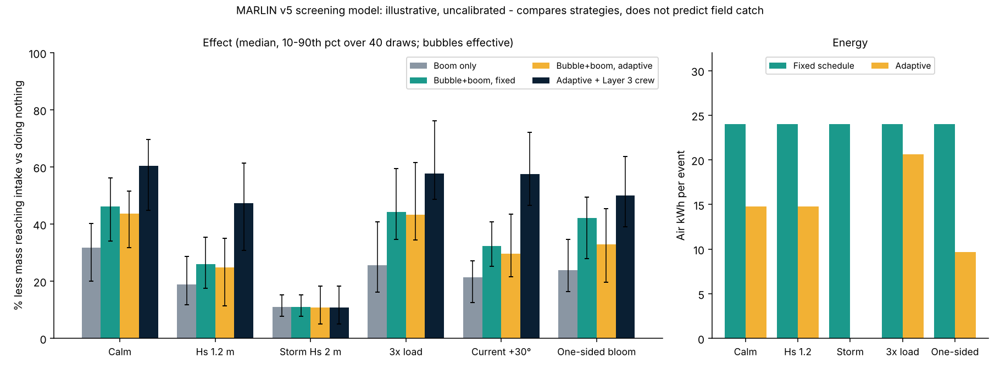

# MARLIN: Marine Adaptive Response and Lifecycle Intervention Network

Post-alert response to seasonal jellyfish blooms near a coastal nuclear plant, for the ATRC ChallengeON **Advanced Technology Pioneers 2026 - ENEC track**.

**Team:** Bashger Aljneibi, Keyal Doshi, Abdul Fattah Mohammed, Abdul Bari Mohammed

## Concept
ENEC already detects blooms offshore. MARLIN starts after that alert and reduces manual clearing, without touching plant or nuclear-safety systems.

| Part | Role |
|---|---|
| Layer 1: bubble curtain | Lifts drifting jellyfish toward the surface |
| Layer 2: angled floating boom | Guides them along its face to one collection point |
| Adaptive control software | Estimates arrivals, sets curtain air per zone and the boom angle, switches off when nothing arrives |
| Layer 3: manual catch | A small crew sweeps any rare straggler |
| Existing intake screens | Stay untouched as the last line of defense |

## Repository contents
| Path | What |
|---|---|
| `deck/` | 10-slide proposal deck (PPTX and PDF) |
| `simulation/v5/` | Self-contained hybrid screening simulation (Python + numpy) and 15 tests |
| `outputs/v5/` | Report, CSV, JSON and chart from the final run |
| `docs/STRATEGY_V5.md` | Strategy, ENEC criteria mapping, findings, limits, next steps |
| `UPDATE_NOTES.md` | Notes on the update and how it relates to the earlier prototype |

## Run the simulation
```
cd simulation/v5
python test_hybrid.py      # 15 checks, about 10 s
python run_scenarios.py    # full Monte Carlo run, about 6 min
```

## Key results (illustrative, uncalibrated)
Share of jellyfish mass kept from reaching the intake, compared with doing nothing (median over 40 draws):

- Bubbles plus boom beat the boom alone in calm seas: **52% vs 36%**, and they add nothing if bubbles do not lift animals.
- The manual-catch Layer 3 adds roughly **11-19 points** in calm and moderate seas.
- Adaptive control cuts air energy by about **38%** (and to zero with no bloom), but did **not** improve catch over fixed settings. Better catch from adaptive control is a hypothesis for flume testing.
- In a 2 m storm every strategy drops to about **12%**.



## Honest limits
The model compares strategies under placeholder parameters. It is plan-view only: no CFD, intake hydraulics, bycatch or injury, and no trained ML or computer vision. It is not a prediction of field performance. Full details are in `outputs/v5/RUN_REPORT.md` and `docs/STRATEGY_V5.md`.

AI tools supported the research and drafting; the team explains every decision and result in its own words.
